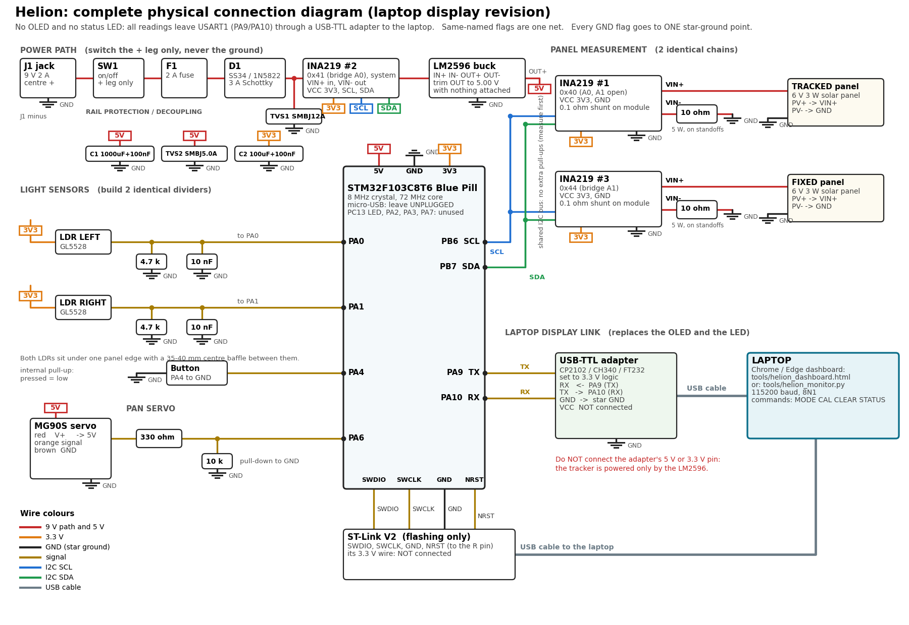

# ☀️ Helion — single-axis solar tracker

[]()
[]()
[]()
[]()

Helion keeps a solar panel facing the brightest direction using two LDRs and a servo. It runs on a **Blue Pill (STM32F103C8T6)** and streams live telemetry to a laptop dashboard or Python monitor over a USB-to-serial cable.

**Two builds from one firmware:**

| | Bare rig | Full project |
|---|---|---|
| **Hardware** | Blue Pill + 2 LDRs + SG90 servo | + LM2596 buck, 3x INA219, 2x solar panel, load resistors |
| **Power** | Blue Pill micro-USB | 9 V adapter to LM2596 |
| **Flash command** | `pio run -e rig -t upload` | `pio run -e helion -t upload` |
| **What it measures** | Light direction only | + panel power, system power, tracking gain |
| **Who it is for** | First build / prototype | Outdoor install / full benchmark |

> **Status:** the firmware logic has 77 host-side unit tests and compiles warning-free with `-Wall -Wextra`. It has **not** been run on real hardware by the author. Treat the first power-up as a test.

---

## Contents

1. [Bare rig — quick start](#1-bare-rig--quick-start)
2. [Full project — what it adds](#2-full-project--what-it-adds)
3. [Wiring — full project](#3-wiring--full-project)
4. [Bill of materials](#4-bill-of-materials)
5. [Build and flash](#5-build-and-flash)
6. [Laptop display](#6-laptop-display)
7. [Bring-up order — full project](#7-bring-up-order--full-project)
8. [Operation and tuning](#8-operation-and-tuning)
9. [Tests](#9-tests)
10. [Repository layout](#10-repository-layout)
11. [Known limits](#11-known-limits)
12. [Author and license](#12-author-and-license)

---

## 1. Bare rig — quick start

The bare rig needs no power supply, no INA219 sensors and no solar panels. It is the fastest way to see the tracker working.

### 1.1 What you need

| Item | Qty | Notes |
|---|:--:|---|
| STM32F103C8T6 Blue Pill | 1 | Solder 2x20 header pins to both long edges if not already done |
| ST-Link V2 + ribbon cable | 1 | SWD programmer |
| SG90 servo + horn + screw | 1 | |
| LDR (GL5528 or similar) | 2 | |
| Resistor 4.7 kohm (10 kohm also works) | 2 | LDR voltage dividers — **not optional** |
| Half-size breadboard | 1 | |
| Male-male jumper wires | ~12 | Male-female adapters useful for LDR legs |
| Cardboard, glue, tape | — | Plate ~8 x 5 cm; fin 4 cm tall |
| Tactile button | 1 | Optional — mode switch / calibrate |
| Capacitor 100-470 uF | 1 | Optional — across servo 5 V/GND if board resets on servo move |

### 1.2 Cautions — read before powering up

1. Power the Blue Pill **only from its own micro-USB cable** in the bare rig. Never connect the ST-Link 3.3 V or 5 V pins (two supplies fighting can damage the board).
2. **Never feed 5 V into A0 or A1.** Those pins accept 3.3 V maximum. LDR dividers go to the **3.3** pin; the servo goes to **5V**.
3. **Servo wires: red to 5V, brown to GND, orange to A6.** Reversed power destroys the servo.
4. **Never turn the servo horn by hand** while powered (SG90 plastic gears strip). Fit the horn only after the servo has centred itself (step 5 below).
5. An SG90 can pull 0.5-0.7 A when pushing against a stop. A laptop USB port gives 0.5 A — the board may reset. Use a light plate, keep it free to swing, or add a 100-470 uF capacitor across servo 5 V and GND.
6. Keep the yellow BOOT0 and BOOT1 jumpers on the **0** side.

### 1.3 Build the cardboard head

1. Cut a plate ~8 x 5 cm. Glue a 4 cm tall strip upright across the middle along the 5 cm direction: the **fin**.
2. Mark two spots near the front edge, one each side of the fin, about 4 cm apart. Glue or tape one LDR at each spot, both facing forward, legs pointing back.
3. Fit a jumper wire on each LDR leg (tape it so it cannot slip). LDRs have no polarity.
4. Do **not** glue the plate to the servo yet — wait until step 5.

*Left and right below are as seen from behind the plate, looking at the light.*

### 1.4 Wire the breadboard

Place the Blue Pill in the middle of the breadboard (USB socket at one end).

**Rail convention:** top + rail = 3.3 V | top - rail = GND | bottom + rail = 5 V | bottom - rail = GND. Join the two - rails with one jumper.

| # | Wire | Notes |
|---|---|---|
| 1 | Blue Pill **3.3** to top + rail | 3.3 V supply |
| 2 | Blue Pill **G** (top row) to top - rail | GND |
| 3 | Blue Pill **5V** (bottom row) to bottom + rail | 5 V supply for servo |
| 4 | Blue Pill **G** (bottom row) to bottom - rail | GND |
| 5 | top - rail to bottom - rail | Common ground |
| 6 | LDR LEFT leg 1 to top + rail | |
| 7 | LDR LEFT leg 2 to **A0** column | |
| 8 | Resistor 1: one leg in A0 column, other leg to top - rail | Pull-down |
| 9 | LDR RIGHT leg 1 to top + rail | |
| 10 | LDR RIGHT leg 2 to **A1** column | |
| 11 | Resistor 2: one leg in A1 column, other leg to top - rail | Pull-down |
| 12 | SG90 **red** to bottom + rail (5 V) | |
| 13 | SG90 **brown** to bottom - rail (GND) | |
| 14 | SG90 **orange** to **A6** column | |
| 15 | Optional button: **A4** column to top - rail | Mode switch |

See wiring diagram: `docs/rig_wiring_diagram.png`

#### ST-Link to Blue Pill SWD header (4 wires)

| ST-Link pin | Blue Pill |
|---|---|
| SWCLK | SWD header **CLK** |
| SWDIO | SWD header **DIO** |
| GND | SWD header **GND** |
| RST (recommended) | **R** pin (top row) |

Leave the ST-Link 3.3 V and 5 V pins **unconnected**.

### 1.5 Install PlatformIO and flash

1. Install **VS Code** → Extensions → search **PlatformIO IDE** → install → restart. The first launch downloads tools (~300 MB, internet needed once).
2. **File → Open Folder** → choose this repo root. PlatformIO detects `platformio.ini`.
3. Plug the **Blue Pill micro-USB** into the laptop (PWR LED lights).
4. Plug the **ST-Link** into the laptop.
5. In the PlatformIO tab click **rig → Upload**, or in the terminal:
   ```
   pio run -e rig -t upload
   ```
   Success: `Programming Started ... Verified OK ... Resetting Target ... SUCCESS`

#### If the upload fails

| Message | Fix |
|---|---|
| `UNEXPECTED idcode` | Clone chip — remove the `;` before `upload_flags` in `platformio.ini` and upload again |
| `init mode failed` / `target not found` | Check CLK/DIO/GND wires; connect RST; try holding the Blue Pill reset button and release just as upload starts |
| Compile errors | Copy the red lines and open an issue |
| No ST-Link found (Windows) | Install the ST-Link driver (STSW-LINK009 from st.com), try another USB port |

### 1.6 First run

1. After flashing, the servo **centres** (~600 ms). Keep your hand clear.
2. Power off. Fit the servo horn pointing straight along the servo body and screw it in. Glue the cardboard plate to the horn so it points forward.
3. Power on again. The plate **sweeps its full range** (~2 s, ~110 degrees) then settles toward the brightest direction. Keep the path clear.
4. Move a torch ~30 cm in front and sweep it left/right slowly. The plate should follow within about a second.

#### If it does not behave

| Symptom | Fix |
|---|---|
| Turns **away** from the light | Swap the A0 and A1 wires, or set `#define PAN_DIR (-1)` in `Core/Src/main.c` and re-flash |
| Hunts to one end and sticks | Same as above — this is the runaway safety stop; fix direction then press the button twice or power-cycle |
| Does nothing / rests on one side | Too dark (parked) or in FIELD mode — use a bright lamp, press the button once |
| Rests off-centre in even light | LDRs are mismatched — calibrate (section 8.2) |
| Jitters at rest | Lamp is on mains AC and flickers — set `MAINS_HZ` 50 or 60 to match your supply |
| Buzzes at the end stops | Narrow `PAN_MIN_PULSE`/`PAN_MAX_PULSE` to e.g. 1100/1900 in `main.c` |
| Board resets when servo moves | Servo current — see caution 5 in section 1.2 |

---

## 2. Full project — what it adds

The full project adds:

- **LM2596 buck converter** — steps the 9 V adapter down to 5 V for the Blue Pill and servo
- **3x INA219 power sensors** on I2C — measure tracked panel, system input, and fixed reference panel
- **2x matched solar panels** into 10 ohm loads — one tracked, one fixed, for a live tracking gain benchmark
- **USB-to-TTL adapter** — streams telemetry to the laptop dashboard at 115200 8N1
- **Protection circuit** — diode, fuse, TVS clamps, bulk capacitors

In the full project the Blue Pill **micro-USB must stay unplugged** because the LM2596 powers the 5 V net. Flash over ST-Link SWD only.

Use `pio run -e helion -t upload` (or just `pio run -t upload`).

---

## 3. Wiring — full project



### 3.1 Power path

```
J1 (+) -> SW1 -> F1 (2 A) -> D1 (3 A Schottky) -+-> INA219 #2 VIN+ -> VIN- -> LM2596 IN+
                                                  +-> TVS1 (SMBJ12A) -> GND
J1 (-) ------------------------------------------------> STAR GND <-- LM2596 IN-, OUT-

LM2596 OUT+ -> 5 V rail -+-> C1 (1000 uF + 100 nF) -> GND
                         +-> TVS2 (SMBJ5.0A) -> GND
                         +-> Servo red wire
                         +-> Blue Pill 5V pin

Blue Pill 3V3 -> LDR top legs (x2), INA219 VCC (x3), C2 (100 uF + 100 nF) -> GND
```

### 3.2 Point-to-point connection list

| # | From | To | Notes |
|---|---|---|---|
| **Power path** | | | |
| 1 | 9 V adapter (+) to J1 | SW1 to F1 (2 A) to D1 anode | Switch the **+** leg only |
| 2 | D1 cathode (9V node) | INA219 #2 VIN+ | Measures whole system input |
| 3 | 9V node | TVS1 SMBJ12A cathode (anode to GND) | Input surge clamp |
| 4 | INA219 #2 VIN- | LM2596 IN+ | |
| 5 | J1 (-), LM2596 IN- and OUT- | Star GND | |
| 6 | LM2596 OUT+ | **5 V rail** | Trim to 5.00 V +/- 0.05 with nothing attached |
| **5 V rail** | | | |
| 7 | 5 V rail | Blue Pill 5V pin | |
| 8 | 5 V rail | Servo red wire | |
| 9 | 5 V rail | C1 (1000 uF parallel 100 nF), TVS2 SMBJ5.0A cathode | Both to GND, solder close to the Blue Pill |
| **3.3 V rail** (from Blue Pill 3V3) | | | |
| 10 | 3V3 | LDR Left top leg, LDR Right top leg | |
| 11 | 3V3 | VCC of INA219 #1, #2, #3 | |
| 12 | 3V3 | C2 (100 uF parallel 100 nF) to GND | Near INA219 cluster |
| **Sensors and actuator** | | | |
| 13 | LDR Left bottom leg | PA0, 4.7 kohm to GND, 10 nF to GND | Divider node |
| 14 | LDR Right bottom leg | PA1, 4.7 kohm to GND, 10 nF to GND | Divider node |
| 15 | PA4 | Pushbutton to GND | Internal pull-up |
| 16 | PA6 | 330 ohm to servo orange (signal) | 10 kohm from signal to GND |
| 17 | Servo brown | Star GND | |
| **I2C bus** | | | |
| 18 | PB6 (SCL) | SCL of INA219 #1, #2, #3 | Check pull-ups before adding — see section 7 step 4 |
| 19 | PB7 (SDA) | SDA of INA219 #1, #2, #3 | |
| 20 | INA219 address pads | #1 none (0x40), #2 bridge A0 (0x41), #3 bridge A1 (0x44) | |
| **Solar panels** | | | |
| 21 | Tracked panel PV+ | INA219 #1 VIN+ | |
| 22 | INA219 #1 VIN- | 10 ohm 5 W to GND | PV- to GND |
| 23 | Fixed panel PV+ | INA219 #3 VIN+ | |
| 24 | INA219 #3 VIN- | 10 ohm 5 W to GND | Resistors matched within +/-0.1 ohm |
| **Laptop serial link** | | | |
| 25 | PA9 (USART1 TX) | USB-TTL adapter **RX** | |
| 26 | PA10 (USART1 RX) | USB-TTL adapter **TX** | |
| 27 | Adapter GND | Star GND | **Do not connect adapter VCC** |
| 28 | Adapter USB | Laptop | Set adapter to 3.3 V logic if it has a jumper |
| **Programming** | | | |
| 29 | ST-Link SWDIO / SWCLK / GND | PA13 / PA14 / GND | |
| 30 | ST-Link NRST | Blue Pill **R** pin | Connect under reset |
| 31 | ST-Link 3.3 V | **Not connected** | Board is powered from LM2596 |

*Not connected: PC13 (on-board LED, unused), PA2, PA3, PA7. Blue Pill micro-USB: **unplugged**.*

### 3.3 Pin map

| Pin | Function | Connected to |
|---|---|---|
| PA0 | ADC1_IN0 | Left LDR divider (0-3.3 V only) |
| PA1 | ADC1_IN1 | Right LDR divider (0-3.3 V only) |
| PA4 | GPIO input, pull-up | Mode / calibrate button (to GND) |
| PA6 | TIM3_CH1 | Pan servo PWM (50 Hz, 900-2100 us) |
| PB6 / PB7 | I2C1 SCL / SDA | INA219 x3 |
| PA9 / PA10 | USART1 TX / RX | USB-TTL adapter, 115200 8N1 |
| PA13 / PA14 | SWDIO / SWCLK | ST-Link |

### 3.4 LDR baffle

Mount both LDRs side by side on the panel edge facing the sun with a **35-40 mm vertical fin** between them. The fin shades one LDR when the panel is off-angle; without it both LDRs see nearly the same light and tracking is sluggish.

Left LDR to PA0, Right LDR to PA1.

### 3.5 Hardware lessons built in

| Problem | Fix used here |
|---|---|
| 1N5819 is a 1 A part; a stalled servo draws more | 3 A SS34 / 1N5822 |
| Failed LM2596 puts full input voltage on the 5 V servo | TVS2 SMBJ5.0A on the 5 V rail + 2 A fuse upstream |
| Input surge / wrong adapter (INA219 VIN+ rated 26 V) | TVS1 SMBJ12A after D1 |
| Switch in the ground leg | Switch the **+** leg only |
| Blue Pill USB and 5V pin are the same net | Flash over SWD only, USB unplugged, adapter VCC unconnected |
| Stacked I2C pull-ups | Measure SDA to 3V3 before adding any (want 1.5-10 kohm) |
| Weak 3.3 V LDO on clone boards | 100 uF + 100 nF near the INA219 cluster |
| Servo signal ringing | 330 ohm series + 10 kohm pull-down on PA6 |
| Load resistors dissipate ~2.7 W each on 5 W parts | Metal standoffs, away from panels and printed parts |
| Breadboard in the 5 V servo path outdoors | Solder on perfboard, >= 20 AWG |

---

## 4. Bill of materials

### 4.1 Bare rig only

| Item | Qty | Notes |
|---|:--:|---|
| STM32F103C8T6 Blue Pill | 1 | Buy a spare |
| ST-Link V2 + ribbon | 1 | |
| SG90 servo + horns + screw | 1 | |
| LDR (GL5528) | 2 | |
| Resistor 4.7 kohm | 2 | LDR dividers |
| Half-size breadboard | 1 | |
| Jumper wires | ~12 | |
| Cardboard, glue, tape | — | |
| Tactile button | 1 | Optional |
| Capacitor 100-470 uF | 1 | Optional |

### 4.2 Full project additions

| Item | Qty | Notes |
|---|:--:|---|
| TowerPro MG90S servo | 1 | Metal gear; replaces SG90 for outdoor use |
| GL5528 LDR | 2 | Same |
| INA219 breakout (with A0/A1 solder pads) | 3 | |
| 6 V 3 W solar panel | 2 | Matched pair: 1 tracked, 1 fixed |
| 10 ohm 5 W resistor | 2 | Matched +/-0.1 ohm, mount on metal standoffs |
| LM2596 buck module | 1 | |
| 9 V 2 A DC adapter, 5.5x2.1 mm centre-positive | 1 | |
| DC barrel jack + slide switch | 1 + 1 | |
| 2 A fuse (glass or PPTC) | 1 | |
| SS34 or 1N5822 Schottky, 3 A | 1 | **Not** 1N5819 (1 A) |
| SMBJ12A TVS | 1 | Input clamp (TVS1) |
| SMBJ5.0A TVS | 1 | 5 V clamp (TVS2); avoid 1.5KE5.6A — it leaks at 5.1 V |
| 1000 uF 16 V low-ESR electrolytic | 1 | C1 |
| 100 uF electrolytic | 1 | C2 on the 3.3 V rail |
| 100 nF ceramic | 3 | Across C1, C2, and the INA219 cluster |
| 10 nF ceramic | 2 | LDR dividers |
| 4.7 kohm resistor | 2 | LDR dividers |
| 10 kohm resistor | 1 | Servo signal pull-down |
| 330 ohm resistor | 1 | Servo signal series |
| Tactile pushbutton | 1 | |
| USB-to-TTL adapter (CP2102, CH340, or FT232) | 1 | Must support 3.3 V logic |
| Perfboard, >= 20 AWG wire, enclosure | — | Solder the servo and 5 V wiring; no breadboard outdoors |

---

## 5. Build and flash

### 5.1 PlatformIO (recommended)

```
# Bare rig (2 LDRs + servo, no INA219):
pio run -e rig -t upload

# Full project (INA219 sensors + panels):
pio run -e helion -t upload

# Serial monitor (USB-TTL adapter port):
pio device monitor
```

`platformio.ini` downloads the ARM compiler and STM32 HAL automatically on the first build.

> **Clone Blue Pill (CKS32 / GD32)?** If upload fails with `UNEXPECTED idcode`, open `platformio.ini` and remove the `;` before the `upload_flags` line, then upload again.

### 5.2 STM32CubeIDE (alternative)

1. New project for **STM32F103C8Tx**, clock = HSE crystal, debug = Serial Wire, **no peripherals enabled** in the `.ioc`.
2. Copy `Core/Src/main.c`, `Core/Src/stm32f1xx_it.c`, `Core/Inc/main.h`, and `Core/Inc/stm32f1xx_hal_conf.h` over the generated files (`main.c` contains its own `HAL_*_MspInit` callbacks — delete any duplicates CubeMX generated).
3. In `STM32F103C8TX_FLASH.ld` set `FLASH ... LENGTH = 63K` (or use the included script directly).
4. For the bare rig build, add `-DHAVE_INA219=0` to the C compiler flags.

---

## 6. Laptop display

### 6.1 Dashboard (Chrome or Edge — nothing to install)

1. Plug the USB-TTL adapter into the laptop (RX to PA9, TX to PA10, GND to GND, VCC **unconnected**).
2. Open `tools/helion_dashboard.html` by double-clicking it. Click **Connect to tracker** and pick the adapter's COM port.
3. The dashboard shows: link state, mode, tracking state, tracked and fixed power, tracking gain %, energy collected, system input power, servo position and error, a live power graph, an event log, and buttons for Switch DEMO/FIELD, Calibrate LDRs, Clear fault, Ask for status, Download log (CSV).
4. Click **Simulate** to try the dashboard with fake data before the hardware exists.

> Firefox and Safari do not support the Web Serial API — use the Python monitor below.

### 6.2 Python monitor (any OS)

```bash
pip install pyserial
python tools/helion_monitor.py --list               # find the port
python tools/helion_monitor.py COM5                 # Windows
python tools/helion_monitor.py /dev/ttyUSB0 --csv log.csv   # Linux
```

Type `MODE`, `CAL`, `CLEAR` or `STATUS` + Enter to send commands. Any serial terminal (PuTTY, `pio device monitor`) at 115200 8N1 also works.

### 6.3 Serial protocol

One telemetry line per second, plus event lines whenever something changes. All numbers are integers.

```
$HEL,t=412,mode=DEMO,st=TRACK,flt=0,az=-120,pan=1510,sum=3200,lim=0,ina=7,tv=5810,ti=3120,tp=1813,fv=5790,fi=2680,fp=1552,sv=8920,si=4100,sp=3657,gain=168,et=42,ef=36*29
#EVT FAULT PAN RUNAWAY (check PAN_DIR / horn / blocked panel)
```

| Key | Meaning | Unit |
|---|---|---|
| `t` | Uptime | s |
| `mode` | `DEMO` (adjusts every 0.3 s) or `FIELD` (every 30 s) | |
| `st` | `TRACK`, `SEARCH`, `PARK` (night), or `FAULT` | |
| `flt` | Fault bits: 1 = pan runaway, 2 = LDR open/shorted | |
| `az` | Normalised left/right error (positive = brighter right) | 0.1 % |
| `pan` | Servo pulse width | us |
| `sum` | Total light (sum of both LDR readings, 0-8190) | ADC counts |
| `lim` | 1 = servo at end of travel (not a fault) | |
| `ina` | INA219 online bits: 1 = tracked, 2 = system, 4 = fixed (7 = all) | |
| `tv` `fv` `sv` | Voltage: tracked panel, fixed panel, system input | mV |
| `ti` `fi` `si` | Current | 0.1 mA |
| `tp` `fp` `sp` | Power | mW |
| `gain` | Tracked / fixed - 1 (`na` if fixed panel is dark) | 0.1 % |
| `et` `ef` | Energy since reset: tracked, fixed | 0.1 mWh |

`*HH` is the XOR checksum of every character between `$` and `*`. Lines starting with `#` are free text. The microcontroller does not need the laptop — with the cable unplugged, tracking continues unchanged.

**Commands** (one per line, case-insensitive, `\n` or `\r\n`):

| Command | Effect |
|---|---|
| `MODE` | Toggle DEMO <-> FIELD and clear faults |
| `CAL` | Calibrate LDR gains (point both LDRs at even light first) |
| `CLEAR` | Clear faults |
| `STATUS` | Send a telemetry line immediately |

---

## 7. Bring-up order — full project

Follow these steps in order. Each has a clear pass/fail.

1. **Unpowered continuity** — measure between each pair: 5 V to GND, 3V3 to GND, 5 V to 3V3, 9 V to GND. All must read > 1 kohm.
2. **LM2596 alone** (nothing on its output): power up, trim to **5.00 V +/- 0.05 V**, seal the trim screw.
3. **Blue Pill alone** on the 5 V rail: 3V3 pin must read **3.30 V +/- 0.1 V**.
4. **I2C pull-ups check**: power off, measure SDA to 3V3 and SCL to 3V3. Want 1.5-10 kohm. If lower, the INA219 modules have built-in resistors that are already stacking — do **not** add extra 4.7 kohm resistors.
5. **Flash over SWD** (ST-Link plugged in, Blue Pill USB unplugged). Then plug in the USB-TTL adapter and open the dashboard. You must see the `#HELION ... fw=5.0` boot banner.
6. **INA219 check**: `#BOOT ina=7` means all three answered. Any other value names the missing sensor (bit 1 = tracked, 2 = system, 4 = fixed) — check its address bridge and wiring.
7. **LDR dividers**: shine a torch on each LDR; `sum` rises and `az` swings sign. A dead channel raises `FAULT LDR`.
8. **Servo last** — ideally from a bench supply limited to ~1 A. No reset or garbled text on serial at start-up. Run the sweep test to set limits (see section 8.1).
9. **Direction test** in DEMO mode with a torch. If the tracker runs away, flip `PAN_DIR`.
10. **Calibrate** — hold the button > 2 s (or send `CAL`) under diffuse, even light. Expect `#EVT CAL SAVED`. Power-cycle and confirm it persists.
11. **Night test** — cover the LDR head. It should park after ~1.5 s in DEMO (`#EVT PARKED`). Uncover — it sweeps and resumes tracking.
12. **Panels last** — connect both solar panels through the INA219s and load resistors. Verify `gain` in the dashboard.

---

## 8. Operation and tuning

### 8.1 Behaviour summary

| Event | What happens |
|---|---|
| **Power-up** | Servo centres -> if dark, parks; otherwise sweeps full range and moves to brightest position |
| **Button short press** | DEMO <-> FIELD, clears faults |
| **Button hold > 2 s** | Calibrate LDR gains (same as `CAL` command) |
| **Night** | After ~1.5 s of darkness (DEMO) the tracker parks at PARK_PAN_PULSE; at dawn it sweeps and resumes |
| **Fault: runaway** | 40 same-direction steps without the error shrinking -> servo holds. Cause: wrong PAN_DIR, slipped horn, blocked panel |
| **Fault: LDR open** | One channel ~0 while the other is lit -> servo holds. Self-clears when the channel recovers |
| **Clear faults** | Short button press or CLEAR command |
| **Limit** | Servo reaches end of travel while error was still improving -> lim=1, not a fault |
| **Watchdog** | 4 s. A watchdog reset is reported in the boot banner as wdg_reset=1 |

### 8.2 Things to tune (top of `Core/Src/main.c`)

| Setting | Default | What to do |
|---|---|---|
| `PAN_DIR` | +1 | Flip to -1 if the servo runs away from a torch |
| `PAN_MIN_PULSE` / `PAN_MAX_PULSE` | 900 / 2100 us | Set SERVO_SWEEP_TEST 1, flash, watch `#EVT SWEEP PULSE ...`, listen for grinding, keep limits ~50 us inside where it binds, set back to 0 |
| `PARK_PAN_PULSE` | 2000 us | Aim at where the sun rises. With PAN_DIR +1 a higher pulse turns toward the **right** LDR |
| `NIGHT_ENTER_ADC_SUM` / `NIGHT_EXIT_ADC_SUM` | 400 / 900 | Watch `sum` in the dashboard at dusk and pick thresholds |
| `MAINS_HZ` | 50 | Set 60 in 60 Hz countries |
| `K_MISMATCH_X1000` | 1000 | Run both panels flat side-by-side; set P_fixed / P_tracked x 1000 |
| `BOOT_MODE` | MODE_DEMO | Use MODE_FIELD for a permanent outdoor install |
| `SERIAL_INTERVAL_MS` | 1000 | Telemetry period |

---

## 9. Tests

The firmware logic is tested with a host-side test suite that runs on any PC — no STM32 toolchain needed.

```bash
# Linux / macOS
cd tests
gcc -std=c11 -Wall -Wextra -Wshadow -I. test.c -o test && ./test
```

```powershell
# Windows
cd tests
gcc -std=c11 -Wall -Wextra -Wshadow -I. test.c -o test.exe; .\test.exe
```

To test the bare rig build (HAVE_INA219=0):
```powershell
gcc -std=c11 -Wall -Wextra -Wshadow -DHAVE_INA219=0 -I. test.c -o test_bare.exe; .\test_bare.exe
```

**77 checks** cover: INA219 maths, azimuth controller and its fault logic, LDR fault detection, calibration maths and flash round-trip, night logic, sun search, telemetry line format (checksum, all keys, worst-case length), event lines, and every laptop command including malformed input.

`tests/main.h` is a fake of the STM32 HAL for the PC — it is **not** the header for the real project.

---

## 10. Repository layout

```
Core/
  Src/main.c                  Firmware (all logic in one file)
  Src/stm32f1xx_it.c          Exception handlers
  Inc/main.h                  Peripheral type definitions
  Inc/stm32f1xx_hal_conf.h    HAL modules enabled
STM32F103C8TX_FLASH.ld        Linker script (63 KB code + 1 KB calibration page)
platformio.ini                Build config (env:helion and env:rig)
tools/
  helion_dashboard.html       Laptop dashboard (Chrome/Edge, Web Serial)
  helion_monitor.py           Python serial monitor + CSV logger
tests/
  test.c                      Host-side unit tests
  main.h                      Fake STM32 HAL for tests
docs/
  CARDBOARD_RIG.md            Bare rig reference (parts, pinout, quick steps)
  STEP_BY_STEP_RIG.md         Beginner step-by-step guide for the bare rig
  make_rig_diagram.py         Generates docs/rig_wiring_diagram.png
  rig_wiring_diagram.png      Breadboard wiring diagram for the bare rig
  wiring_diagram.png          Schematic wiring for the full project
images/
  blue_pill_pinout.jpg        Blue Pill pinout reference
  ina219_module.jpg           INA219 breakout
  ldr_divider_circuit.jpg     LDR voltage divider (correct circuit)
  lm2596_module.jpg           LM2596 buck module
  mg90s_servo.jpg             MG90S servo
  protection_components.jpg   Protection parts (use a 3 A diode, not 1N5819 shown)
.gitignore
README.md                     This file
```

---

## 11. Known limits

- A **runaway fault stays latched** until a short press or `CLEAR`. An unattended tracker holds position until someone resets it.
- **Mode (DEMO/FIELD) is not saved to flash** — use `BOOT_MODE MODE_FIELD` in `main.c` for a permanent outdoor install.
- **Energy totals are in RAM** and lost on reset. The dashboard/monitor CSV is the permanent log — keep the laptop connected to record.
- **Calibration is stored in flash** (last 1 KB page at `0x0800FC00`) and survives power cycles.
- The sun's daily arc can be wider than the servo's ~110-120 degrees of travel. `lim=1` at the extremes is normal; aim the park position at the middle of the sun's arc.

---

## 12. Author and license

**Muhammed Shifan** ([@Bit-wisely](https://github.com/Bit-wisely)) — MIT License.
