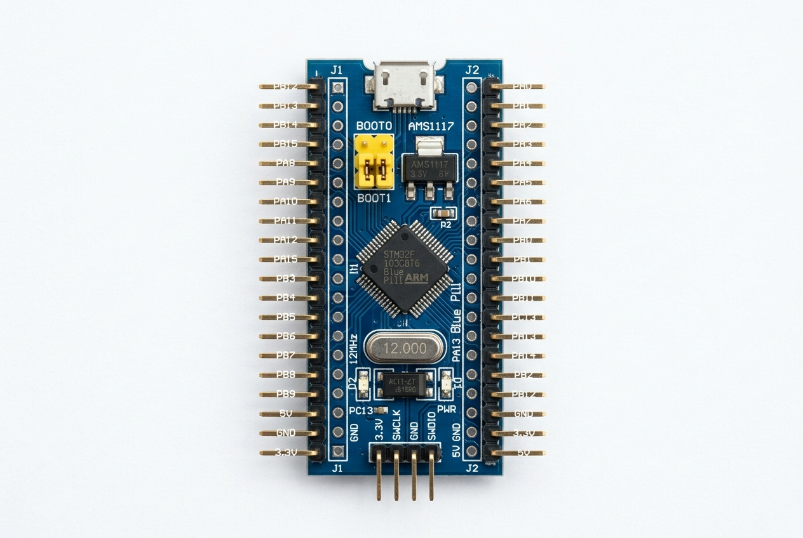
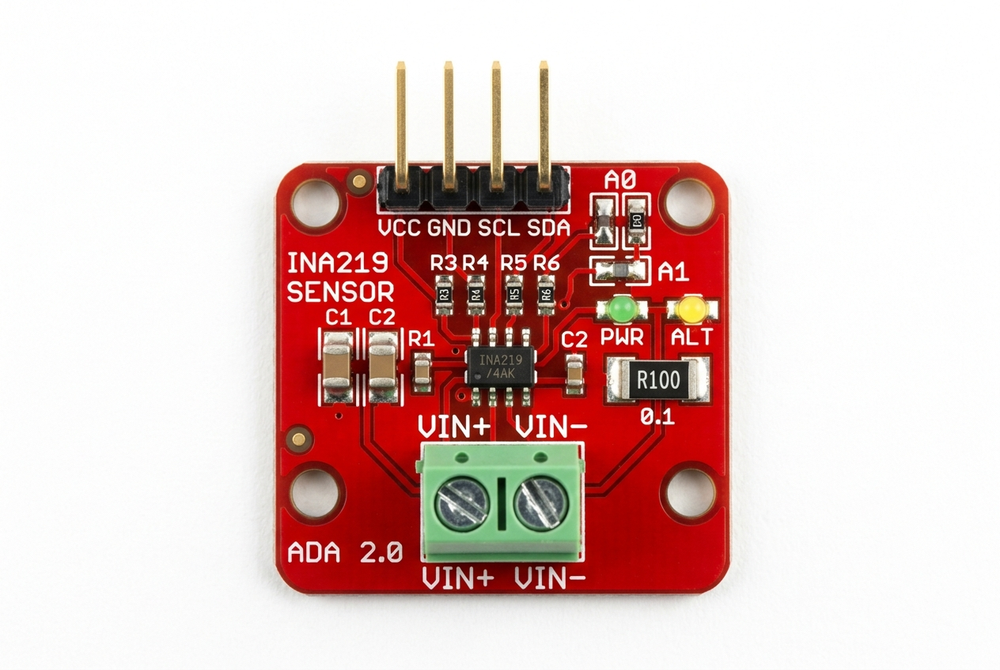
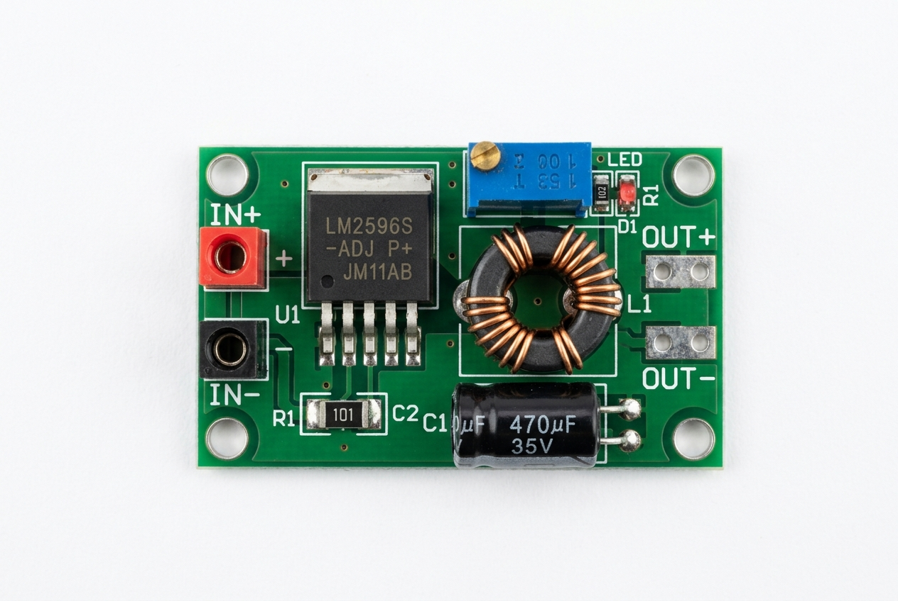
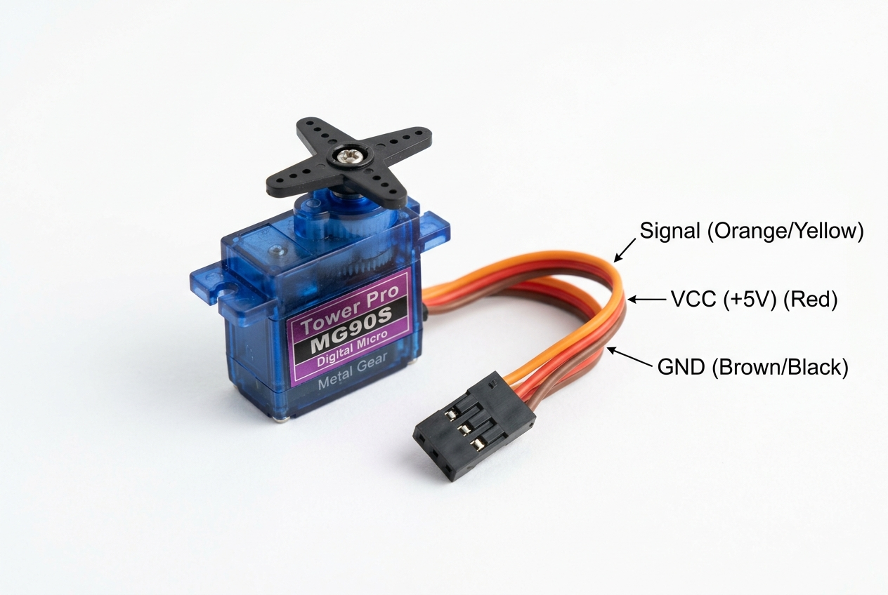
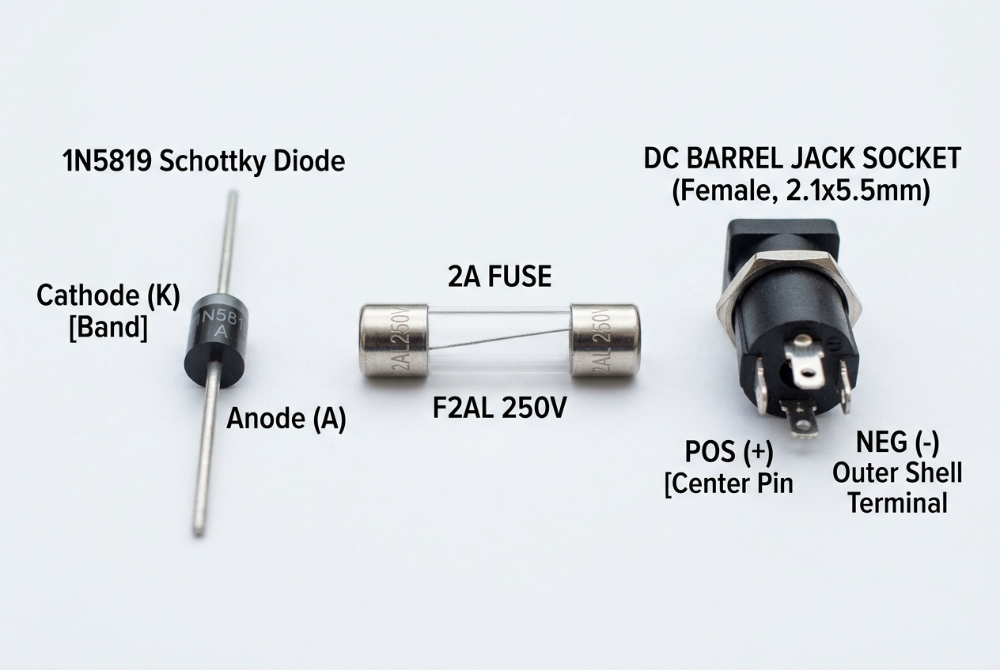
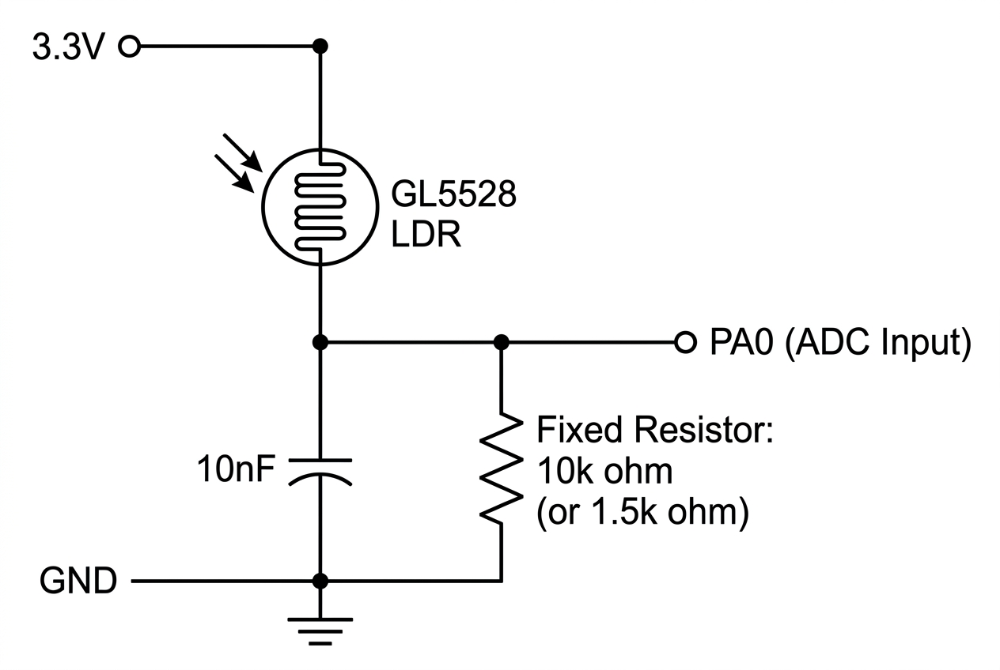

# ☀️ Helion: single-axis solar tracker with laptop display

[]()
[]()
[]()
[]()

Helion keeps a 6 V solar panel facing the sun along the east-west axis and measures, at the same time,
how much more energy it collects than an identical fixed panel and how much power the electronics use.

**Revision 5: no OLED and no LED.** Everything that used to be on the OLED is now shown on the **laptop**:
the tracker streams one text line per second over a USB-to-serial cable, and a dashboard in the browser
(or a small Python monitor) shows it live, draws the power graph, logs to CSV and can send commands back.

* Tracking: two LDRs (PA0 left, PA1 right) with a centre baffle, normalised error, MG90S servo on PA6.
* Telemetry: three INA219 sensors on I²C (`0x40` tracked panel, `0x41` system input, `0x44` fixed panel).
* Benchmark: tracked panel against an identical fixed panel, each into a 10 Ω load.
* Protection: reverse-polarity diode, 2 A fuse, TVS clamps on both rails, 4 s watchdog, runaway and open-LDR fault detection.

---

## 1. Wiring (build exactly this)


*(Regenerate with `python3 docs/make_wiring_diagram.py`; vector copy: `docs/wiring_diagram.svg`.)*
Same-named flags are one net. **Every GND goes to one star-ground point.**

### Point-to-point connection list

| # | From | To | Notes |
|---|---|---|---|
| **Power path** | | | |
| 1 | 9 V adapter (centre +) → J1 | SW1 → F1 (2 A) → D1 anode | switch the **+ leg** only |
| 2 | D1 cathode (node *9V*) | INA219 #2 `VIN+` | |
| 3 | node *9V* | TVS1 SMBJ12A cathode (anode to GND) | input surge clamp |
| 4 | INA219 #2 `VIN−` | LM2596 `IN+` | measures the whole system input |
| 5 | J1 (−), LM2596 `IN−` and `OUT−` | star GND | |
| 6 | LM2596 `OUT+` | **5 V rail** | trim to 5.00 V ± 0.05 with nothing attached |
| **5 V rail** | | | |
| 7 | 5 V rail | Blue Pill `5V` pin | |
| 8 | 5 V rail | servo red wire | |
| 9 | 5 V rail | C1 1000 µF (+) with 100 nF in parallel, TVS2 SMBJ5.0A cathode | both to GND, solder close to the Blue Pill |
| **3.3 V rail** (from Blue Pill `3V3` pin) | | | |
| 10 | 3V3 | LDR Left top leg, LDR Right top leg | |
| 11 | 3V3 | VCC of INA219 #1, #2, #3 | |
| 12 | 3V3 | C2 100 µF + 100 nF to GND | near the INA219 cluster |
| **Sensors and actuator** | | | |
| 13 | LDR Left bottom leg | PA0, 4.7 kΩ to GND, 10 nF to GND | divider node |
| 14 | LDR Right bottom leg | PA1, 4.7 kΩ to GND, 10 nF to GND | divider node |
| 15 | PA4 | pushbutton → GND | internal pull-up |
| 16 | PA6 | 330 Ω → servo orange (signal) | 10 kΩ from the servo-signal side to GND |
| 17 | servo brown | star GND | |
| **I²C bus** | | | |
| 18 | PB6 (SCL) | SCL of INA219 #1, #2, #3 | no extra pull-ups (see §6) |
| 19 | PB7 (SDA) | SDA of INA219 #1, #2, #3 | |
| 20 | INA219 address pads | #1 none (0x40), #2 bridge **A0** (0x41), #3 bridge **A1** (0x44) | |
| **Panels** (two identical chains) | | | |
| 21 | tracked panel PV+ | INA219 #1 `VIN+` | |
| 22 | INA219 #1 `VIN−` | 10 Ω 5 W → GND | PV− to GND |
| 23 | fixed panel PV+ | INA219 #3 `VIN+` | |
| 24 | INA219 #3 `VIN−` | 10 Ω 5 W → GND | PV− to GND; resistors matched within ±0.1 Ω |
| **Laptop display link** | | | |
| 25 | PA9 (USART1 TX) | USB-TTL adapter **RX** | |
| 26 | PA10 (USART1 RX) | USB-TTL adapter **TX** | |
| 27 | adapter GND | star GND | **do not connect the adapter's VCC / 5 V / 3.3 V** |
| 28 | adapter USB | laptop | adapter set to 3.3 V logic if it has a jumper |
| **Programming** | | | |
| 29 | ST-Link SWDIO / SWCLK / GND | PA13 / PA14 / GND | |
| 30 | ST-Link NRST | Blue Pill `R` pin | lets the ST-Link reset the chip ("connect under reset") |
| 31 | ST-Link 3.3 V | **not connected** | the board is powered from the LM2596 |

Not connected: PC13 (on-board LED, unused), PA2, PA3, PA7. Blue Pill micro-USB: **unplugged**
(its power pin is the same net as the `5V` header pin).

### Pin map

| Pin | Function | Connected to |
|---|---|---|
| PA0 | ADC1_IN0 | Left LDR divider (0 to 3.3 V only) |
| PA1 | ADC1_IN1 | Right LDR divider (0 to 3.3 V only) |
| PA4 | GPIO input, pull-up | Mode / calibrate button (to GND) |
| PA6 | TIM3_CH1 | Pan servo PWM (50 Hz, 900 to 2100 µs) |
| PB6 / PB7 | I2C1 SCL / SDA | INA219 ×3 |
| PA9 / PA10 | USART1 TX / RX | USB-TTL adapter, 115200 8N1 |
| PA13 / PA14 | SWDIO / SWCLK | ST-Link |

### LDR and baffle

Mount both LDRs side by side on the panel edge facing the sun with a **35 to 40 mm vertical baffle** between them.
The baffle shades one LDR when the panel is off-angle; without it both see nearly the same light and tracking is sluggish.
Left LDR = PA0, Right LDR = PA1. Which compass direction "right" is depends on how you mount it
(see `PAN_DIR` and `PARK_PAN_PULSE` below).

---

## 2. Bill of materials

| Item | Qty | Notes |
|---|:--:|---|
| STM32F103C8T6 Blue Pill | 1 | buy a spare |
| ST-Link V2 | 1 | SWD programmer |
| **USB-to-TTL adapter** (CP2102, CH340 or FT232) | 1 | **new**: the laptop display link; must do 3.3 V logic |
| TowerPro MG90S servo | 1 | metal gear |
| GL5528 LDR | 2 | |
| INA219 breakout (with A0/A1 solder pads) | 3 | |
| 6 V 3 W solar panel | 2 | matched pair: 1 tracked, 1 fixed |
| 10 Ω 5 W resistor | 2 | matched ±0.1 Ω, mount on metal standoffs |
| LM2596 buck module | 1 | |
| 9 V 2 A DC adapter, 5.5 × 2.1 mm centre-positive | 1 | |
| DC barrel jack + slide switch | 1 + 1 | |
| 2 A fuse (glass or PPTC) | 1 | |
| SS34 or 1N5822 Schottky, 3 A | 1 | **not** 1N5819 (1 A) |
| SMBJ12A TVS | 1 | input clamp (TVS1) |
| SMBJ5.0A TVS | 1 | 5 V clamp (TVS2); avoid 1.5KE5.6A, it leaks at 5.1 V |
| 1000 µF 16 V low-ESR electrolytic | 1 | C1 |
| 100 µF electrolytic | 1 | C2 on the 3.3 V rail |
| 100 nF ceramic | 3 | across C1, C2 and the INA219 cluster |
| 10 nF ceramic | 2 | LDR dividers |
| 4.7 kΩ resistor | 2 | LDR dividers |
| 10 kΩ resistor | 1 | servo signal pull-down |
| 330 Ω resistor | 1 | servo signal series |
| Tactile pushbutton | 1 | |
| Perfboard, ≥ 20 AWG wire, enclosure | | solder the servo and 5 V wiring; no breadboard outdoors |

**No longer needed:** SSD1306 OLED, 100 µF cap for the OLED, status LED.

---

## 3. Build and flash the firmware

### Option A (recommended): PlatformIO

1. Install [PlatformIO](https://platformio.org/install) (VS Code extension or `pip install platformio`).
2. Open this folder. Connect the ST-Link (wiring list rows 29 to 31) and power the tracker from the 9 V adapter.
3. `pio run -t upload`

`platformio.ini` already points at `Core/Src` and `Core/Inc`, uses the included linker script
(63 KB of flash for code; the last 1 KB page holds the LDR calibration) and downloads the toolchain and the STM32 HAL.

### Option B: STM32CubeIDE

1. New project for **STM32F103C8Tx**, clock = HSE crystal, debug = Serial Wire, **no peripherals enabled** in the `.ioc`.
2. Copy `Core/Src/main.c`, `Core/Src/stm32f1xx_it.c`, `Core/Inc/main.h`, `Core/Inc/stm32f1xx_hal_conf.h` over the generated files
   (`main.c` contains its own `HAL_*_MspInit` callbacks; delete the duplicates if CubeMX generated any).
3. In `STM32F103C8TX_FLASH.ld` set `FLASH ... LENGTH = 63K` (or copy the included script).

> **Status:** the firmware logic is unit-tested on a PC against a fake HAL (77 checks, §8) and the real code path
> compiles warning-free with `-Wall -Wextra -Wconversion`. It has **not** been built with the ARM toolchain or run on
> hardware by the author. Treat the first power-up as a test and follow §6 in order.

---

## 4. Laptop display

### Dashboard (Chrome or Edge, nothing to install)

1. Plug the USB-TTL adapter into the laptop.
2. Open `tools/helion_dashboard.html` by double-clicking it. Click **Connect to tracker** and pick the adapter's port.
3. You see: link state, mode, tracking state, tracked and fixed power, tracking gain in %, energy collected, system input power,
   servo position and error, a live power graph, an event log, and buttons for **Switch DEMO / FIELD**, **Calibrate LDRs**,
   **Clear fault**, **Ask for status** and **Download log (CSV)**.
4. **Simulate** shows the dashboard with fake data so you can try it before the hardware exists.

Firefox and Safari do not support the Web Serial API; use the Python monitor there.

### Python monitor (any OS)

```
pip install pyserial
python tools/helion_monitor.py --list              # find the port
python tools/helion_monitor.py COM5 --csv log.csv  # Windows;  Linux: /dev/ttyUSB0, macOS: /dev/cu.usbserial-*
```

Type `MODE`, `CAL`, `CLEAR` or `STATUS` + Enter to send a command. Any serial terminal (PuTTY, `pio device monitor`) at
115200 8N1 also works; the lines are plain text.

### Serial protocol

One telemetry line per second, plus event lines whenever something changes. All numbers are integers.

```
$HEL,t=412,mode=DEMO,st=TRACK,flt=0,az=-120,pan=1510,sum=3200,lim=0,ina=7,tv=5810,ti=3120,tp=1813,fv=5790,fi=2680,fp=1552,sv=8920,si=4100,sp=3657,gain=168,et=42,ef=36*29
#EVT FAULT PAN RUNAWAY (check PAN_DIR / horn / blocked panel)
```

| Key | Meaning | Unit |
|---|---|---|
| `t` | uptime | s |
| `mode` | `DEMO` (adjusts every 0.3 s) or `FIELD` (every 30 s) | |
| `st` | `TRACK`, `SEARCH`, `PARK` (night) or `FAULT` | |
| `flt` | fault bits: 1 = pan runaway, 2 = LDR open/shorted | |
| `az` | normalised left/right light error (positive = brighter on the right) | 0.1 % |
| `pan` | servo pulse width | µs |
| `sum` | total light, sum of both LDR readings (0 to 8190) | ADC counts |
| `lim` | 1 = servo at the end of its travel (not a fault) | |
| `ina` | INA219 online bits: 1 = tracked, 2 = system, 4 = fixed (7 = all) | |
| `tv` `fv` `sv` | voltage: tracked panel, fixed panel, system input | mV |
| `ti` `fi` `si` | current | 0.1 mA |
| `tp` `fp` `sp` | power | mW |
| `gain` | tracked power / fixed power − 1 (`na` if the fixed panel is dark) | 0.1 % |
| `et` `ef` | energy since reset: tracked, fixed | 0.1 mWh |

`*HH` is the XOR of every character between `$` and `*`, in hex; the dashboard and monitor drop lines that fail it.
Lines starting with `#` are free text (boot banner, events). The microcontroller does not need the laptop: with the cable
unplugged tracking and logging to RAM carry on unchanged.

Commands (one per line, case-insensitive, `\n` or `\r\n`): `MODE` toggles DEMO/FIELD and clears faults, `CAL` calibrates the LDR
gains (point both LDRs at even light first), `CLEAR` clears faults, `STATUS` sends a telemetry line now. Anything else answers
`#EVT UNKNOWN COMMAND` and changes nothing.

---

## 5. Operation

* **Boot:** servo centres; if dark the tracker parks, otherwise it sweeps the full range and moves to the brightest position.
* **Button (PA4):** short press = DEMO ⇄ FIELD (and clears faults); hold > 2 s = calibrate LDR gains under even light. Same as `MODE` / `CAL`.
* **Night:** after ≈ 1.5 s (DEMO) of darkness it parks at `PARK_PAN_PULSE`; at dawn it sweeps and resumes.
* **Faults** (servo holds, `st=FAULT`, `#EVT FAULT …`): *runaway* = 40 same-direction steps without improvement (wrong `PAN_DIR`,
  slipped horn, blocked panel); *LDR* = one channel ≈ 0 while the other is lit (clears itself). `CLEAR` or a short press resets.
* **Watchdog:** 4 s. After a watchdog reset the boot banner shows `wdg_reset=1`.
* Hitting the end of travel while the error was still improving is `lim=1`, not a fault.

### Things to tune (top of `Core/Src/main.c`)

| Item | How |
|---|---|
| `PAN_DIR` | If the servo runs away from a torch, flip the sign; the runaway fault will tell you. |
| `PAN_MIN/MAX_PULSE` | Set `SERVO_SWEEP_TEST 1`, flash, watch `#EVT SWEEP PULSE …` and listen for grinding; keep limits ≈ 50 µs inside where it binds; set it back to 0. |
| `PARK_PAN_PULSE` | Aim at the sunrise side. With `PAN_DIR` +1 a higher pulse turns towards the **right** LDR. |
| `NIGHT_ENTER/EXIT_ADC_SUM` | Watch `sum` at dusk in the dashboard and pick thresholds. Defaults suit a 4.7 kΩ divider. |
| `MAINS_HZ` | 50 or 60. Sets the ADC averaging window to one mains cycle. |
| `K_MISMATCH_X1000` | Run both panels flat side by side; set `P_fixed / P_tracked × 1000`. |
| `BOOT_MODE` | `MODE_FIELD` for a permanent outdoor install. |
| `SERIAL_INTERVAL_MS` | Telemetry period (default 1000). |

---

## 6. Bring-up order (each step has a pass/fail)

1. **Unpowered continuity:** 5 V↔GND, 3V3↔GND, 5 V↔3V3, 9 V↔GND all open (> 1 kΩ).
2. **LM2596 alone** (nothing on its output): trim to 5.00 V and seal the screw.
3. **Blue Pill alone** on the 5 V rail: `3V3` pin = 3.30 V ± 0.1.
4. **I²C pull-ups:** power off, measure SDA→3V3: want 1.5 kΩ to 10 kΩ. Never add 4.7 kΩ "just in case".
5. **Flash over SWD.** Then plug in the USB-TTL adapter and open the dashboard: you must see the `#HELION … fw=5.0` banner.
   `#BOOT ina=7` means all three INA219s answered; anything else names the missing one (3 = fixed panel missing, 5 = system, 6 = tracked).
6. **LDR dividers:** torch on each LDR; `sum` rises and `az` swings sign. A dead channel raises `FAULT LDR`.
7. **Servo last**, ideally from a bench supply limited to ~1 A. No reset or garbled text at start-up.
8. **Sweep test** to set the limits, then restore `SERVO_SWEEP_TEST 0`.
9. **Direction test** in DEMO with a torch. If it runs away, flip `PAN_DIR`.
10. **Calibrate** (hold the button or press the dashboard button under diffuse light). Expect `#EVT CAL SAVED`; power-cycle and check it persists.
11. **Night test:** cover the head; it parks after ≈ 1.5 s in DEMO (`#EVT PARKED`); uncover and it sweeps and resumes.
12. **Panels last:** connect both panels through the INA219s and load resistors; compare `gain`.

### Hardware lessons built into the design

| Problem | Fix used here |
|---|---|
| 1N5819 is a 1 A part; a stalled servo draws more | 3 A SS34 / 1N5822 |
| Failed LM2596 would put the full input voltage on the 5 V-only servo | TVS2 on the 5 V rail plus the 2 A fuse upstream |
| Input surge or wrong adapter (INA219 VIN+ is rated 26 V) | TVS1 SMBJ12A after D1 |
| Switch in the ground leg | switch the + leg only |
| USB and the `5V` pin are the same net | program over SWD only, Blue Pill USB unplugged, adapter VCC unconnected |
| Stacked I²C pull-ups | measure first (step 4) |
| Weak 3.3 V LDO on clone boards | 100 µF + 100 nF near the INA219 cluster |
| Servo signal ringing | 330 Ω series + 10 kΩ pull-down on PA6 |
| Load resistors dissipate ≈ 2.7 W each | metal standoffs, away from panels and printed parts |
| Breadboard in the 5 V / GND servo path | solder on perfboard |
| Servo load vs stall rating | balance the panel on its pivot; keep `FIELD_RELEASE_SERVOS` and `PARK_RELEASE_SERVO` at 0 |
| Servo covers ≈ 110-120°, the sun's arc can be wider | aim the rest position at the middle of the arc; `lim=1` at the extremes is normal |
| Cables across the pan axis wear out | service loop |
| Moisture, UV, wind | enclosure, conformal coat, PETG/ASA |

### Known limits

* A runaway fault stays latched until `CLEAR` or a short press, so an unattended tracker holds position until someone resets it.
* Mode, energy totals and telemetry history live in RAM and are lost on reset. The dashboard CSV is the permanent log; keep the laptop connected to record.
* Calibration is stored in flash (last 1 KB page) and survives power cycles.

---

## 7. Component photos

| Component | Photo |
|---|---|
| Blue Pill pinout |  |
| INA219 module |  |
| LM2596 module |  |
| MG90S servo |  |
| Protection parts (fit a **3 A** diode, the photo shows a 1N5819) |  |
| LDR divider (correct) |  |

---

## 8. Tests

```
cd tests
gcc -std=c11 -Wall -Wextra -Wshadow -I. test.c -o test && ./test
```

77 checks run `main.c` against a fake HAL: INA219 maths, the azimuth controller and its fault logic, LDR fault detection,
calibration maths and flash round-trip, night logic, sun search, telemetry line format (checksum, all keys, worst-case length),
event lines, and every laptop command including malformed input. `tests/main.h` is a fake of the STM32 HAL for the PC;
it is **not** the header for the real project.

The dashboard's parser and the Python monitor were tested against lines produced by the real firmware code
(`./test sample.txt` writes them).

## 9. Repository layout

```
Core/Src/main.c             firmware        Core/Inc/stm32f1xx_hal_conf.h   HAL modules used
Core/Src/stm32f1xx_it.c     exceptions      STM32F103C8TX_FLASH.ld          linker script (63 KB + calibration page)
platformio.ini              build           tools/helion_dashboard.html     laptop dashboard
tests/                      host tests      tools/helion_monitor.py         laptop serial monitor + CSV
docs/wiring_diagram.png     wiring          docs/archive/                   old dual-axis documents (do not build from)
FIXES.md                    design notes
```

## 10. Author & license

Muhammed Shifan ([@Bit-wisely](https://github.com/Bit-wisely)), MIT License.
