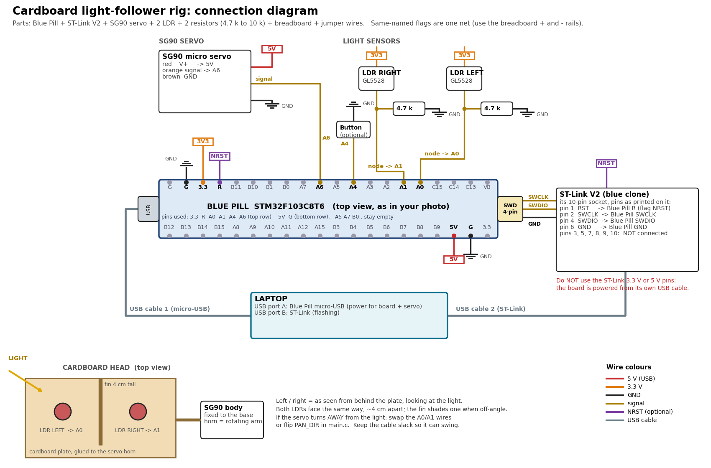

# Cardboard light-follower rig (bare build)

Two LDRs on a cardboard plate, glued to an SG90 servo horn. The servo turns the plate to the brighter side.
This is the same firmware as the full project, built with `-DHAVE_INA219=0` (no power sensors) via `pio run -e rig -t upload`.

## Parts

| Part | Have in photos | Notes |
|---|---|---|
| STM32 Blue Pill | yes | needs header pins soldered on both long edges to use the breadboard (the photo shows bare holes); the 4-pin SWD header is already fitted |
| ST-Link V2 + ribbon | yes | |
| SG90 servo + horns + screws | yes | |
| LDR (GL5528 type) | at least 1 | you need **2** |
| Half-size breadboard, jumper wires | yes | the servo plug is female, so use male-male jumpers to reach the breadboard |
| **2 resistors, 4.7 kΩ (10 kΩ also works)** | not shown | needed for the LDR voltage dividers |
| Button, 100-470 µF capacitor | not shown | optional (button = mode switch; capacitor across servo 5 V/GND helps if the board resets when the servo moves) |
| USB-TTL adapter | not shown | only for the laptop dashboard; the rig works without it |

## Connections

| # | From | To |
|---|---|---|
| 1 | Blue Pill **3.3** (top row) | + rail A (3V3 rail) |
| 2 | Blue Pill **G** (top row) | - rail (GND rail) |
| 3 | + rail A | LDR LEFT leg 1 and LDR RIGHT leg 1 |
| 4 | LDR LEFT leg 2 | Blue Pill **A0**, and one end of resistor 1 |
| 5 | LDR RIGHT leg 2 | Blue Pill **A1**, and one end of resistor 2 |
| 6 | other end of resistors 1 and 2 | - rail (GND) |
| 7 | Blue Pill **5V** (bottom row) | + rail B (5V rail, separate from rail A) |
| 8 | Blue Pill **G** (bottom row) | - rail (GND), same rail as 2 |
| 9 | SG90 red | + rail B (5 V) |
| 10 | SG90 brown | - rail (GND) |
| 11 | SG90 orange | Blue Pill **A6** |
| 12 | optional button | Blue Pill **A4** to - rail |
| 13 | ST-Link pin 2 (SWCLK) | Blue Pill SWD header CLK |
| 14 | ST-Link pin 4 (SWDIO) | Blue Pill SWD header DIO |
| 15 | ST-Link pin 6 (GND) | Blue Pill SWD header GND |
| 16 | ST-Link pin 1 (RST), optional | Blue Pill **R** (top row) |
| 17 | Blue Pill micro-USB | laptop (power for the board and servo) |
| 18 | ST-Link USB | laptop (flashing) |

Leave the ST-Link 3.3 V / 5 V pins unconnected. Read the CLK / DIO / GND labels printed under the Blue Pill's 4-pin header
and match them; the order in the diagram is by function, not by position.
Both yellow BOOT jumpers should be on the **0** side. **Do not** use the LM2596 or the 9 V adapter in this rig.

## Mechanical

1. Fix the SG90 to a base. Screw one horn (centred, servo set near mid-travel) to the servo shaft.
2. Glue a cardboard plate (about 8 x 5 cm) to the horn so it turns about the servo shaft.
3. Fix both LDRs on the plate edge facing the light, about 4 cm apart, facing the same way, with a 4 cm tall cardboard fin glued between them.
4. Left and right are as seen from behind the plate looking at the light. Keep the wires slack so the plate can swing.

## Build, flash, test

1. `pio run -e rig -t upload` (ST-Link plugged in, Blue Pill USB plugged in for power).
2. At power-up the plate centres and sweeps the whole range, then points at the brightest direction.
3. Move a torch or lamp from side to side about 30 cm away: the plate follows within about a second.
4. If it turns **away** from the light, swap the A0 and A1 wires (or set `PAN_DIR` to `(-1)` in `Core/Src/main.c`).
   If it hunts back and forth to the end stops (`FAULT PAN RUNAWAY` on the serial port), the direction is wrong too.
5. The servo may buzz at its end stops: narrow `PAN_MIN_PULSE` / `PAN_MAX_PULSE` (e.g. 1000 / 2000).

Not verified on hardware: the code has not been run on your board yet.
